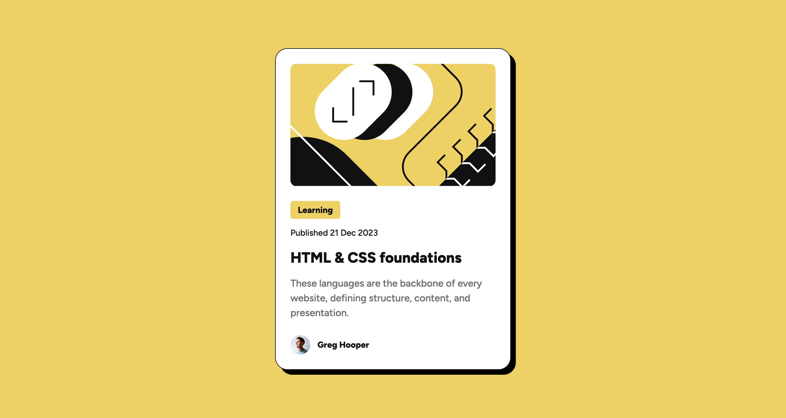

# Frontend Mentor - Blog preview card solution

This is a solution to the [Blog preview card challenge on Frontend Mentor](https://www.frontendmentor.io/challenges/blog-preview-card-ckPaj01IcS). Frontend Mentor challenges help you improve your coding skills by building realistic projects.

## Table of contents

- [Overview](#overview)
  - [The challenge](#the-challenge)
  - [Screenshot](#screenshot)
  - [Links](#links)
- [My process](#my-process)
  - [Built with](#built-with)
  - [What I learned](#what-i-learned)
  - [Useful resources](#useful-resources)
  - [AI Collaboration](#ai-collaboration)
- [Author](#author)

## Overview

### The challenge

Users should be able to:

- See hover and focus states for all interactive elements on the page

### Screenshot



### Links

- Solution URL: https://github.com/LU-Joanne/Blog-preview-card-solution
- Live Site URL: https://lu-joanne.github.io/Blog-preview-card-solution/

## My process

### Built with

- Semantic HTML5 markup
- CSS custom properties
- Flexbox

### What I learned

box-shadow 的屬性值為多種屬性值的組合，各個屬性值之間使用空白分隔。

- offset-x：第一個數值為陰影的 x 位移（使用 px），正往右，負往左。
- offset-y：第二個數值為陰影的 y 位移（使用 px），正往下，負往上。
- blur-radius：第三個數值為陰影的模糊半徑（使用 px），最小為 0，數值越大越模糊。
- spread-radius：第四個數值為陰影的縮放半徑（使用 px），正變大，負變小。
- color：陰影顏色，支援 CSS 所有色彩單位寫法。

```css
.card {
  box-shadow: 8px 8px black;
}
```

### Useful resources

- [box-shadow - CSS - MDN Web Docs - Mozilla
  ](https://developer.mozilla.org/zh-TW/docs/Web/CSS/Reference/Properties/box-shadow) - This helped me learn how to apply box-shadow. I really liked this pattern and will use it going forward.

### AI Collaboration

- GitHub Copilot, Google AI Overviews
- debugging, generating boilerplate, guiding me in optimizing my code

## Author

- Website - [Joanne](https://github.com/LU-Joanne)
- Frontend Mentor - [@LU-Joanne](https://www.frontendmentor.io/profile/LU-Joanne)
